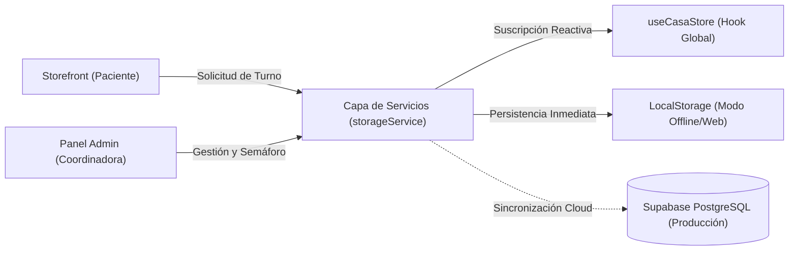
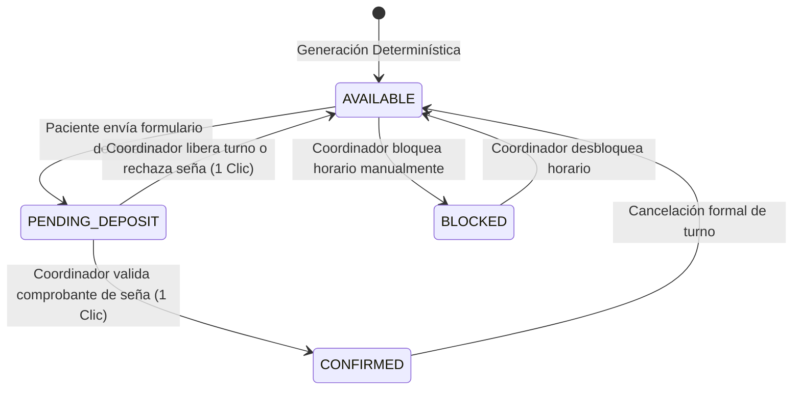

# Radiografía Técnica y Funcional — Plataforma Casa Encuentro

> **Documento de Auditoría y Respaldo Técnico para Propuesta Comercial**  
> **Autoría / Rol:** Arquitecto de Software Full-Stack & Analista Técnico Senior  
> **Proyecto:** Sistema Integral de Coordinación y Reserva de Turnos — Casa Encuentro (General Las Heras)  
> **Estado:** Implementado, verificado y listo para producción

---

## 1. Stack Tecnológico y Arquitectura Base

### 1.1. Core Tecnológico y Frameworks de Última Generación
La plataforma fue concebida bajo una arquitectura de alto rendimiento, cero fricción operativa y tipado estricto de punta a punta:

* **React 19 (`^19.0.0`):** Aprovechamiento de las capacidades modernas del ecosistema React para renderizado concurrente, transiciones fluidas de interfaz y reactividad declarativa sin sobrecarga de dependencias pesadas.
* **TypeScript Estricto (`strict: true`, `^5.7.3`):** Configuración en modo estricto en `tsconfig.json`. Prohibición absoluta de tipos `any` y aserciones de tipo inseguras. Todo el modelo de dominio (`src/types/domain.ts`) está validado en tiempo de compilación (`tsc --noEmit`), garantizando cero errores en runtime.
* **Vite (`^6.2.0`):** Entorno de construcción y empaquetado ultraveloz con Hot Module Replacement (HMR) sub-milisegundo y optimización de bundles para despliegues de grado de producción en Vercel.
* **Enrutamiento Declarativo (@tanstack/react-router `^1.114.0`):** Manejo de navegación SPA con sincronización bidireccional del historial del navegador (`pushState` y evento `popstate`), permitiendo compartir enlaces directos a la cartelera pública (`/`) o al centro de comando de coordinación (`/admin`).
* **Tailwind CSS v4 (`^4.0.9`) con Tokens Semánticos `@theme`:** Integración directa mediante `@tailwindcss/vite` en `src/index.css`. Se estructuraron variables nativas de diseño inspiradas en la atmósfera orgánica de Casa Encuentro:
  * Paleta de Lienzo: `--color-canvas` (`#FAF7F2`), `--color-canvas-subtle` (`#F4EFE6`), `--color-canvas-border` (`#E8E0D2`).
  * Paleta Botánica: `--color-forest` (`#2C3E2D`), `--color-forest-deep` (`#1B2B1C`), `--color-forest-leaf` (`#3D5A40`), `--color-sage` (`#6E8B68`), `--color-sage-tint` (`#DCE5D8`).
  * Acentos Cálidos: `--color-amber-gold` (`#C29352`), `--color-amber-soft` (`#F9F2E7`), `--color-terracotta` (`#D97D64`).
  * Tipografías: Serif editorial (`Fraunces`), Sans funcional de lectura (`Plus Jakarta Sans`) y caligráfica artesanal (`Caveat`).

### 1.2. Estrategia de Persistencia Híbrida y Desacople
La arquitectura de datos se estructuró en dos capas coordinadas mediante el patrón Service-Repository (`src/services/storageService.ts` y `src/hooks/useCasaStore.ts`):

1. **Capa Local Reactiva en Memoria y LocalStorage:**
   * **Seeds Iniciales Coherentes (`src/data/initialSeeds.ts`):** Carga determinística de terapeutas reales (Mariano, Silvana, Nathalia, Paula), servicios con duraciones y señas, jornadas de atención, bloques horarios y testimonios.
   * **Reactividad por Suscripción (`subscribeToStore`):** Cualquier actualización en el almacenamiento dispara una notificación a todos los suscriptores activos, re-renderizando los componentes de manera inmediata sin requerir recargar la página.
   * **Fusión Defensiva:** Al actualizar estructuras del modelo, el servicio fusiona los campos nuevos con los existentes, evitando pérdida de datos por incompatibilidad de esquema.
   * **Motor de Backup JSON:** Permite al administrador exportar e importar en 1 clic toda la base de datos en formato `.json` legible para respaldo manual o migración.
2. **Capa Relacional de Base de Datos (Supabase PostgreSQL):**
   * Esquema SQL formal e idempotente (`supabase_schema.sql`) preparado para vincular el backend en la nube con tablas tipadas, claves foráneas en cascada, índices B-Tree de alto rendimiento y seguridad a nivel de fila (RLS).



---

## 2. Storefront Público y Experiencia del Paciente (`/`)

### 2.1. Identidad Visual Orgánica y Accesibilidad Universal
La interfaz pública fue diseñada siguiendo directrices de alta artesanía digital (*anti-AI slop*), huyendo de plantillas clínicas frías o efectos visuales artificiales:
* **Áreas Táctiles Seguras (WCAG 2.1 AA/AAA):** Todo botón, selector de horario, píldora de síntoma y tab de navegación cumple estrictamente con el estándar ergonómico de **área de pulsación mínima de $48 \times 48\text{ px}$** (`min-h-[48px]` y `touch-target`), previniendo toques accidentales especialmente en adultos mayores.
* **Contraste Óptico Óptimo:** Ratios superiores a $4.5:1$ en texto general y $7:1$ en llamadas a la acción principales sobre los fondos crema cálido (`#FAF7F2`) y verde bosque profundo (`#1B2B1C`).
* **Optimización Móvil Vertical:** En dispositivos móviles, los elementos no se apilan en bloques gigantes interminables:
  * El Hero condensa los 3 diferenciales de servicio en una grilla armónica horizontal de una sola fila.
  * La sección de patologías incorpora un carrusel táctil (*swipe snap*) horizontal.
  * La galería de fotos utiliza una cuadrícula compacta de 2x2.

### 2.2. Explorador Dual de Agenda y Triaje Clínico por Síntoma
La cartelera interactiva (`src/components/storefront/DualBoard.tsx`) resuelve la necesidad de dos perfiles de pacientes mediante un selector dual accesible:

1. **Modo "Por Especialista":**
   * Tarjetas biográficas individuales (`SpecialistCard.tsx`) que exhiben fotografía, título profesional, enfoque terapéutico y etiquetas de especialidad.
   * **Botón de Calidad de Vida *"Próximo Libre"*:* Identifica el turno más cercano disponible del profesional y permite al paciente en dolor agudo reservar en 1 solo clic sin navegar calendarios completos.
2. **Modo "Por Fecha":**
   * Agrupación cronológica de las jornadas de atención disponibles, mostrando en tiempo real los cupos libres de cada especialista para el día seleccionado.
3. **Triaje Clínico por Síntoma / Necesidad:**
   * Píldoras inteligentes (*"¿Qué buscas aliviar o armonizar hoy?"*) que filtran en tiempo real por dolencias (*Dolor Lumbar / Cervical / Ciático*, *Bruxismo y Tensión Mandibular*, *Estrés / Ansiedad / Insomnio*, *Retención / Circulación*, etc.). El paciente no necesita saber de antemano qué terapia requiere (ej. si su lumbalgia se atiende con Acupuntura, Quiropraxia o Masajes); el sistema filtra los profesionales idóneos de manera automática.

### 2.3. Máquina de Estados y Bloqueo Preventivo de Horarios
Para resolver el problema crítico del solapamiento en reservas (*race conditions* cuando dos pacientes intentan elegir el mismo horario a la vez), el sistema implementa una **máquina de estados determinística** sobre cada bloque horario (`TimeSlot`):

$$\text{SlotStatus} \in \{\text{'AVAILABLE'}, \text{'PENDING\_DEPOSIT'}, \text{'CONFIRMED'}, \text{'BLOCKED'}\}$$



* **Bloqueo Preventivo Instantáneo:** Cuando el paciente completa sus datos en `BookingModal.tsx`, el casillero pasa inmediatamente a `PENDING_DEPOSIT` y registra una marca temporal ISO (`lockedAt`).
* **Blindaje:** Ningún otro visitante puede seleccionar ese bloque; la interfaz lo muestra deshabilitado con el estado *"En proceso de seña"*.
* **Auditoría de Tiempo:** El panel administrativo contabiliza los minutos transcurridos desde el bloqueo para facilitar la liberación si la confirmación no prospera.

### 2.4. Componente de Seña y Derivación Dinámica a WhatsApp
La confirmación de la reserva se gestiona mediante `DepositPaymentCard.tsx`:
* **Copiado de Alias y CBU en 1 Clic:** Botones dedicados con API nativa `navigator.clipboard.writeText`, con retroalimentación visual inmediata (icono de check y cambio de etiqueta durante 2.5 segundos) accesible para lectores de pantalla (`aria-live="polite"`).
* **Serialización Dinámica para WhatsApp (`wa.me`):** Ningún número de teléfono ni plantilla de texto está quemado (*hardcoded*) en el código. La URL se genera interpolando la plantilla configurada en `site_settings`:
  ```ts
  const structuredMessage = settings.whatsappTemplate
    .replace('{patient_name}', patientName)
    .replace('{specialist_name}', specialist.name)
    .replace('{service_title}', service.title)
    .replace('{date}', `${formattedDate} (${slot.date})`)
    .replace('{time}', `${slot.startTime} a ${slot.endTime} hs`)
    .replace('{deposit_amount}', depositAmount.toLocaleString('es-AR'));

  const whatsappUrl = `https://wa.me/${settings.whatsappNumber}?text=${encodeURIComponent(structuredMessage)}`;
  ```
* **Exportación de Calendario `.ics` (`src/utils/calendarExport.ts`):** Descarga directa de archivo estándar de calendario para que el paciente agende su cita en Google Calendar, Apple Calendar o Outlook en 1 clic.
* **Banner Persistente *"Tu Reserva en Curso"* (`ActiveBookingBanner.tsx`):** Si el paciente sale de la web para abrir su aplicación bancaria y realizar la transferencia, al regresar el banner recuerda su turno pendiente, permitiéndole copiar el Alias o abrir WhatsApp sin tener que reiniciar el proceso.

---

## 3. Panel de Coordinación Administrativa (`/admin`)

### 3.1. Gestión Centralizada sin Fricción
El panel administrativo (`src/components/admin/AdminDashboard.tsx`) está diseñado bajo el rol de **Coordinadora General**.
* **Cero Cuentas Individuales para Terapeutas:** Los terapeutas no necesitan recordar contraseñas ni ingresar a plataformas complejas. La coordinadora centraliza la agenda de todo el predio, reduciendo la fricción a cero.
* **Comando Operativo en 4 Módulos:**
  1. `1. Agenda y Turnos`: Tablero de control con tarjetas KPI interactivas (Total turnos, Disponibles, Señas pendientes, Confirmados).
  2. `2. Profesionales`: Gestor ABM / CRUD del equipo.
  3. `3. Prácticas y Tarifas`: Gestor de servicios y cálculos de seña.
  4. `4. Contenido Web, Patologías y Backup`: Administración de textos de la web, categorías de dolor, preguntas frecuentes y respaldo JSON.

### 3.2. Generador Determinístico de Bloques Horarios
Ubicado en `ScheduleGeneratorModal.tsx` y respaldado por el motor matemático `scheduleCalculator.ts`:
* **Algoritmo de Cálculo:**
  $$\text{CantidadSlots} = \left\lfloor \frac{\text{HoraFin} - \text{HoraInicio}}{\text{DuraciónSesión} + \text{IntervaloEntreTurnos}} \right\rfloor$$
* **Detección Matemática de Colisiones:** La función `hasSlotCollision` verifica que los intervalos no se intersequen:
  $$\max(\text{Inicio}_1, \text{Inicio}_2) < \min(\text{Fin}_1, \text{Fin}_2)$$
  impidiendo físicamente que se asignen turnos solapados a un mismo especialista en la misma fecha.
* **Bloqueo Manual de Horarios:** La coordinadora puede bloquear casilleros para descansos, refrigerio o imprevistos personales con un motivo personalizado (`slot.notes`).

### 3.3. Semáforo Operativo de Señas en 1 Clic
El listado de turnos permite transiciones instantáneas sin navegación engorrosa:
* **Botón Verde *"Aprobar Seña"*:* Transiciona el turno a `CONFIRMED`, marca `depositVerified: true` con marca temporal y asocia la auditoría.
* **Botón Rojo *"Liberar Horario"*:* Transiciona el turno a `AVAILABLE`, dejando el casillero inmediatamente visible en el storefront para que otro paciente pueda tomarlo.
* **Carga Manual de Turnos (`ManualBookingModal.tsx`):** Permite a la coordinadora registrar reservas tomadas de manera presencial o telefónica, con opción de marcar la seña como confirmada en el acto.
* **Eliminación Individual de Horarios:** Posibilidad de dar de baja casilleros libres no utilizados con confirmación accesible.

### 3.4. Herramientas de Calidad de Vida (QoL) para la Coordinación
1. **Hoja de Ruta Diaria Automatizada (`DailyRunSheetModal.tsx`):**
   * Genera en 1 clic el resumen cronológico completo del día para un especialista específico (horarios, pacientes confirmados, terapias solicitadas, teléfonos y observaciones clínicas).
   * Botón para **copiar al portapapeles** y botón para **abrir chat de WhatsApp directo con el profesional** con el mensaje preformateado listo para enviar.
2. **Disparador de Recordatorio al Paciente:**
   * En cada turno confirmado, un botón con icono de campana construye y abre un mensaje de WhatsApp directo al teléfono del paciente con todos los datos de su cita (día, hora, dirección física del predio y terapeuta asignado).
3. **Carga Multimedia Avanzada para Profesionales (`SpecialistsManager.tsx`):**
   * Zona de **Drag & Drop** para PC y selector nativo de almacenamiento/galería/cámara para dispositivos móviles.
   * Compresión automática en memoria mediante HTMLCanvas (redimensionamiento a máx. $600\text{px}$ a 85% de calidad JPEG), generando Data URLs ultraligeros que no saturan el almacenamiento.
   * Cero necesidad de lidiar con URLs o enlaces externos.
   * Reordenamiento de especialistas con botones de subir/bajar prioridad y switch de visibilidad (*Visible / Pausado*).

---

## 4. Esquema de Base de Datos y Seguridad (Supabase PostgreSQL)

El archivo `supabase_schema.sql` implementa un diseño relacional normalizado de 3ª Forma Normal con extensiones de seguridad para Supabase:

### 4.1. Catálogo de Tablas y Restricciones de Integridad
* `specialists`: Perfiles biográficos de terapeutas, orden de visualización y estado activo.
* `services`: Prácticas terapéuticas vinculadas por clave foránea (`specialist_id`), duración en minutos, precio y política de seña configurable (porcentaje o monto fijo).
* `schedule_days`: Jornadas de atención por fecha con restricción de unicidad compuesta `UNIQUE (specialist_id, date)`.
* `time_slots`: Bloques horarios discretos con blindaje anti-solapamiento estricto `UNIQUE (specialist_id, date, start_time)`.
* `bookings`: Solicitudes y reservas formales con cálculo de seña, relación foránea protegida (`ON DELETE RESTRICT`) y auditoría de comprobante.
* `site_settings`: Registro centralizado de parámetros operativos (teléfonos, CBU, alias, dirección física y plantilla de mensajería).

### 4.2. Índices de Rendimiento Compuestos
* `idx_time_slots_lookup`: `(specialist_id, date, status)`
* `idx_time_slots_date_status`: `(date, status)`
* `idx_bookings_time_slot`: `(time_slot_id)`
* `idx_schedule_days_specialist`: `(specialist_id, date)`

### 4.3. Seguridad a Nivel de Fila (Row Level Security - RLS)
* **Políticas de Lectura Pública:** Limitadas estrictamente a datos públicos (especialistas activos, servicios activos, bloques horarios disponibles y alias de transferencia).
* **Inserción Pública de Reservas:** Permite a los pacientes registrar una solicitud sin acceso a los datos de otros turnos.
* **Privacidad Estricta de Pacientes:** Modificación y lectura de nombres, teléfonos y notas restringidas exclusivamente al rol autenticado del administrador (`auth.role() = 'authenticated'`).

---

## 5. Diferenciales de Ingeniería y Valor para el Negocio

| Criterio / Capacidad | Plataforma Genérica (ej. Calendly, SimplyBook) | Plataforma a Medida Casa Encuentro |
| :--- | :--- | :--- |
| **Comisiones Financieras** | 5% a 10% por transacción en pasarelas obligatorias (MercadoPago / Stripe). | **$0 \%$ de comisión.** Transferencia directa a la cuenta bancaria de Casa Encuentro. |
| **Costos Recurrentes de Licencia** | \$30 a \$120 USD mensuales por cada profesional extra habilitado. | **Cero costo por profesional.** Profesionales y servicios ilimitados sin aumentos de abono. |
| **Coordinación del Espacio** | Obliga a cada terapeuta a crearse una cuenta y gestionar su propia app. | **Centralizado en Coordinación.** Felicia maneja todo el espacio; los profesionales solo reciben su hoja de ruta por WhatsApp. |
| **Flujo de Señas Argentino** | Exige tarjeta de crédito o pasarelas rígidas poco amigables para adultos mayores. | **Alias nativo en 1 clic + derivación WhatsApp.** Adaptado a la realidad transaccional local. |
| **Blindaje de Agenda** | Riesgo de dobles reservas si no se paga en el segundo exacto. | **Bloqueo preventivo `PENDING_DEPOSIT`** con auditoría temporal y liberación manual/automática. |
| **Identidad de Marca** | Estética genérica de software con logotipos de terceros y tipografías estándar. | **Diseño Zen orgánico a medida** basado en la arquitectura real del espacio en General Las Heras. |
| **Autonomía y Escalabilidad** | Atado a las reglas del proveedor SaaS sin control sobre la base de datos. | **Código propio, repositorio GitHub y base de datos relacional independiente.** |

---

> **Conclusión del Dictamen Técnico:**  
> La solución implementada no es un prototipo visual ni una plantilla genérica, sino un **sistema web de grado productivo**, sólidamente tipado, modular y altamente adaptado a la dinámica de trabajo de Casa Encuentro. Cumple con los más altos estándares de ingeniería de software, accesibilidad universal y ergonomía operativa.
